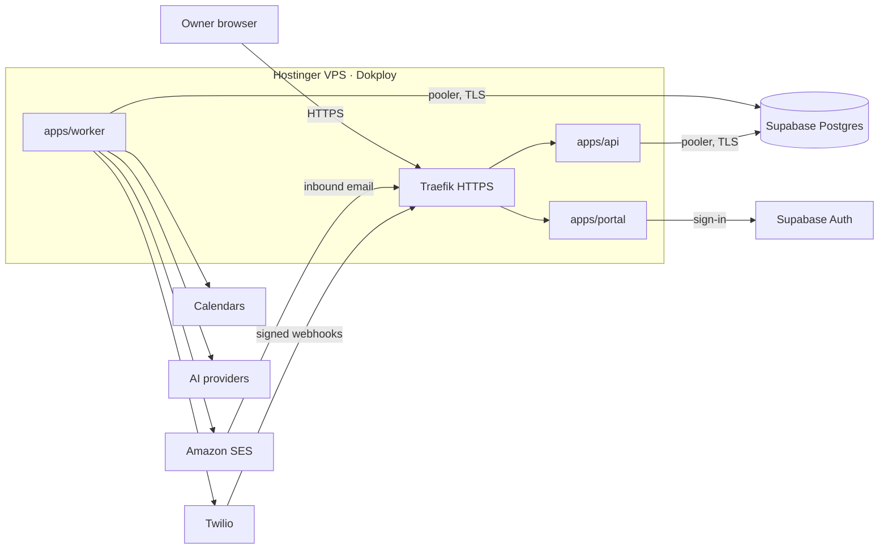

# System Overview

A TypeScript API receives missed calls, texts, forwarded emails and form submissions and commits
each one, with its follow-up jobs, to Postgres in one transaction. A separate worker executes
those jobs (texts, emails, transcription, AI analysis, calendar holds and events, reminders)
with retries and idempotency. A conversation engine moves each lead through clarify → offer →
approve → confirm. Tenants use an owner portal; Fifth Stone Dev uses the operator CLI.
Baseline decisions follow [ADR-0001](../adr/0001-initial-architecture.md); v0.2 changes follow
[ADR-0002](../adr/0002-scope-v0.2-architecture.md). Product scope:
[SCOPE.md v0.2](../product/SCOPE.md).

## Boundaries

| Inside the system                                                                                          | Outside (integrated, not owned)                                                                                                                                                                                                                                        |
| ---------------------------------------------------------------------------------------------------------- | ---------------------------------------------------------------------------------------------------------------------------------------------------------------------------------------------------------------------------------------------------------------------- |
| API, worker, operator CLI, owner portal, Postgres schema, conversation engine, scheduling, prompt compiler | Tenant phone line and call forwarding, Twilio (voice, SMS, compliance registration), Amazon SES (send and receive), Google Calendar, Acuity, transcription and language-model providers, Cloudflare Turnstile, Supabase Auth, tenant website, Google Sheets (optional) |

## Core loop data flow

```mermaid
sequenceDiagram
    participant C as Caller
    participant TW as Twilio
    participant API as apps/api
    participant DB as Postgres
    participant W as apps/worker
    participant AI as Transcription + model
    participant CAL as Calendar
    participant O as Owner / staff

    C->>TW: Call to tenant line, unanswered, forwarded
    TW->>API: Voice webhook (signed)
    API->>DB: BEGIN; inbound_event (unique CallSid); upsert contact + lead;<br/>enqueue text-back (+ transcribe if voicemail); COMMIT
    W->>TW: Send first text (template)
    W->>AI: Transcribe voicemail; analyze (skipped for clinic tenants)
    W->>DB: Store schema-validated result; engine picks next state
    C->>TW: Replies (details, urgency number)
    TW->>API: SMS webhook (signed) -> commit message + jobs
    W->>TW: Next clarifying question, or slot offer
    W->>CAL: Read free/busy; after pick, place tentative hold
    W->>TW: Approval request text to approver
    O->>API: Reply 1/2/3 by text, or act in portal
    API->>DB: Commit decision + jobs
    W->>CAL: Convert hold to event (or release)
    W->>TW: Confirmation text (+ SES email if known)
```

Emergencies branch at the urgency answer: the approver is alerted immediately and, where the
playbook says so, the customer first receives the fixed safety message.

## States (proposed, ADR-0002 decision 6)

| Entity               | States                                                                                                                    |
| -------------------- | ------------------------------------------------------------------------------------------------------------------------- |
| Lead                 | `new` → `clarifying` → `offered` → `requested` → `booked`; also `needs_attention`, `quiet`, `closed`, `spam`, `opted_out` |
| Request              | `pending` → `approved` / `changed` / `declined` / `expired`                                                               |
| Hold                 | `active` → `converted` / `released`                                                                                       |
| Service registration | `not_started` → `submitted` → `approved` / `rejected` (per tenant, per service: texting, email)                           |

Portal lanes are queries over these states: **Needs you** (`needs_attention`, pending
requests, emergencies), **Waiting on customer** (`clarifying`, `offered`), **Booked**
(`booked`), **Went quiet** (`quiet`).

## Modules

| Module                  | Owns                                                                                                                                                                                                                                                                           |
| ----------------------- | ------------------------------------------------------------------------------------------------------------------------------------------------------------------------------------------------------------------------------------------------------------------------------ |
| `packages/core`         | Contact/lead/tenant/event types, Zod validators, normalization, status rules                                                                                                                                                                                                   |
| `packages/connectors`   | Interfaces + adapters: `EmailSender` and `EmailEvents` (SES), `SmsSender` and `PhoneEvents` (Twilio), `CalendarProvider` (Google, Acuity), `TranscriptionProvider`, `LanguageModel`; labeled mocks in `@fsc/connectors/mock`. `LeadDestination` (Sheets) waits for decision 20 |
| `packages/workflow`     | Job claim/lease, backoff with jitter, attempt caps, dead-letter, idempotency keys                                                                                                                                                                                              |
| `packages/conversation` | Lead/request state machine, playbook application, clarifying-question selection, template rendering with locked pieces                                                                                                                                                         |
| `packages/scheduling`   | Slot calculation (hours, job length, urgency, events, holds), hold lifecycle                                                                                                                                                                                                   |
| `packages/ai`           | Prompt compiler from structured settings inside the locked safety layer; output schemas                                                                                                                                                                                        |
| `apps/api`              | Form, signed webhooks, Twilio voice/SMS webhooks, SES inbound, authenticated portal routes, health                                                                                                                                                                             |
| `apps/worker`           | Job loop: texts, emails, transcription, analysis, calendar writes, reminders, hold expiry                                                                                                                                                                                      |
| `apps/portal`           | Owner portal: Today dashboard, lead pages, settings with versions, onboarding, test call                                                                                                                                                                                       |
| `apps/operator`         | CLI: tenants, registrations, enable/disable, failed jobs, replay, status, export/delete                                                                                                                                                                                        |

## Owner-editable vs locked

| Owner edits (portal)                                                      | Locked (Fifth Stone Dev / server-enforced)                        |
| ------------------------------------------------------------------------- | ----------------------------------------------------------------- |
| Template wording                                                          | Business name and opt-out line on first text; registered use case |
| AI settings: what we do / don't do, emergency definition, questions, tone | Safety layer, output schema, no times/prices/commitments from AI  |
| Job types, job lengths, hours, urgency rules                              | Vendor configuration, API keys, sending limits                    |
| Approvers, alert recipients, staff logins                                 | Domain verification, deliverability monitoring                    |
| Email sender name and reply-to                                            | Clinic minimum-data flag (set by playbook)                        |

## Canonical lead shape (v0.1, implemented)

Defined in `packages/core/src/lead.ts` (`LeadInputSchema`). Normalization runs before validation.

| Field                | Rule                                                                        |
| -------------------- | --------------------------------------------------------------------------- |
| `name`               | Required; single line; max 120                                              |
| `email`              | Lowercased; valid address; max 254                                          |
| `phone`              | Normalized to E.164; North American numbers assumed unless `+country` given |
| `service`, `address` | Optional single line; max 120 / 300                                         |
| `message`            | Optional; line breaks kept; max 2000                                        |
| `preferredContact`   | Optional: `email`, `phone`, `text`, `any`                                   |

At least one of `email` or `phone` is required. Unknown fields are rejected, not stored.
Control characters are stripped from all text. Lead statuses: `new` → `contacted` / `closed` /
`spam`; the operator can reopen to `new`. Only `new` leads are unresolved and get reminders.

Job idempotency key: `<actionType>:<leadId>`, unique per tenant. Intake queues
`send_acknowledgment`, `send_owner_alert`, `append_sheet_row`; `send_staff_reminder` is scheduled
at its due time. Integration configs hold secret _names_ (`secretRef`), never values; a Sheets
column mapping must include `leadId` so retries can reconcile instead of duplicating rows.

v0.2 keeps this shape as the contact/intake record and adds the conversation, request and
call entities below. The v0.1 statuses map onto the v0.2 lead states during migration;
`send_staff_reminder` becomes the approval reminder, and `append_sheet_row` is optional.

## Data entities (planned)

v0.1: `tenants`, `tenant_config`, `integration_connections`, `inbound_events`, `leads`, `jobs`,
`job_attempts`, `email_events`, `audit_events`.

v0.2 adds: `contacts` (matched by phone/email), `conversations`, `messages`, `calls`,
`voicemails` (recording reference + transcript), `ai_analyses`, `requests`, `calendar_holds`,
`playbooks`, `tenant_templates` (versioned), `ai_settings` (versioned), `portal_users`,
`opt_outs`, `service_registrations`, `calendar_connections`.

All tenant-owned rows carry `tenant_id`. Secrets and OAuth tokens are referenced by name or
stored encrypted, never in plain tenant config.

## Error behavior

| Failure                                                      | Behavior                                                                                  |
| ------------------------------------------------------------ | ----------------------------------------------------------------------------------------- |
| Invalid input / Turnstile / signature                        | Rejected before persistence; nothing stored                                               |
| Duplicate event                                              | Unique constraint → return original result; no new jobs                                   |
| DB unavailable at intake                                     | 503; source may retry; no partial state                                                   |
| Vendor transient error (429, 5xx, timeout)                   | Retry with exponential backoff + jitter up to cap                                         |
| Vendor permanent error (rejected sender, revoked permission) | Mark failed/dead-letter, alert operator, no infinite retry                                |
| Worker crash mid-job                                         | Lease expires; job reclaimed; reconcile before repeating non-idempotent calls             |
| Tenant disabled                                              | Pending jobs skipped and marked; no new intake                                            |
| Duplicate Twilio webhook (retries)                           | Unique on Twilio CallSid / MessageSid; no second lead or text                             |
| Transcription or model failure                               | Lead continues with a generic first text and lands in **Needs you**; never blocks capture |
| AI output fails schema validation                            | Treated as model failure; output discarded, not sent                                      |
| Calendar read fails                                          | No slots offered; customer told the owner will confirm a time; lead to **Needs you**      |
| Calendar token revoked                                       | Operator and owner alerted; portal shows reconnect; offers paused for that tenant         |
| Customer opted out (STOP)                                    | Outbound text job skipped and marked; never retried                                       |
| Hold expires before approval                                 | Hold released; customer offered fresh slots or told the owner will follow up              |

## Environments and hosting (ADR-0003)



| Environment | Application                          | Database                           |
| ----------- | ------------------------------------ | ---------------------------------- |
| Local       | `npm` processes on the owner machine | Supabase CLI stack, Docker Desktop |
| Staging     | Separate Dokploy app on the VPS      | Hosted Supabase project (staging)  |
| Production  | Dokploy app on the VPS               | Hosted Supabase project (prod)     |

- One deployment serves every tenant. Each request resolves its tenant from the number called,
  the inbound email address, the form's public ID, or the signed-in portal user, then sets the
  tenant context for row-level security (ADR-0003 decision 6).
- Secrets are environment variables from Dokploy. The service-role key exists only on the
  operator's machine.
- The database lives off the VPS, so a VPS failure loses no committed data. Webhooks cannot be
  received while the VPS is down; uptime monitoring is required before pilots.
